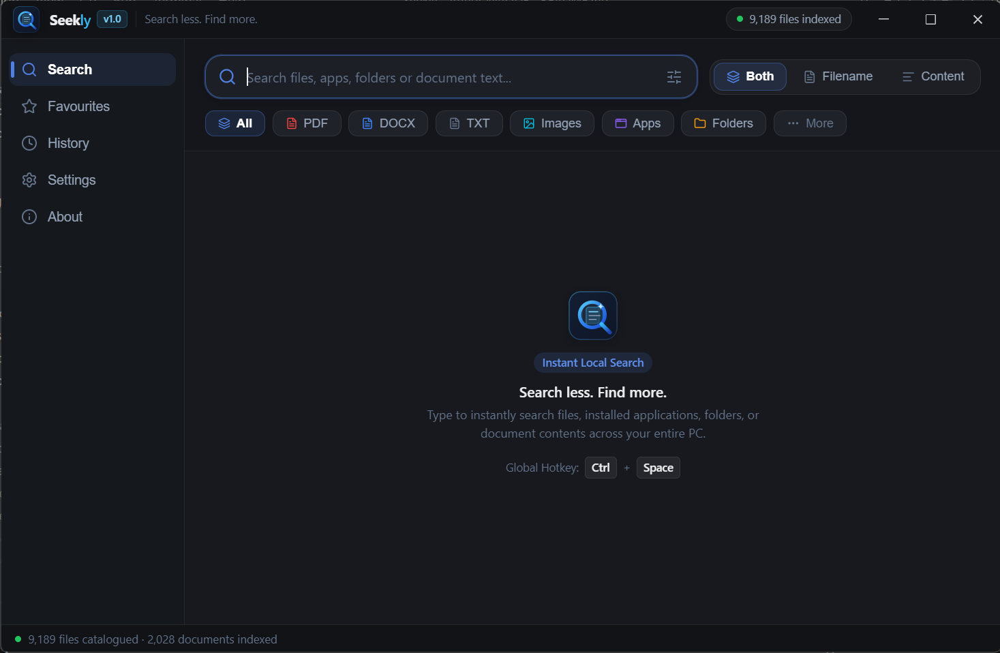
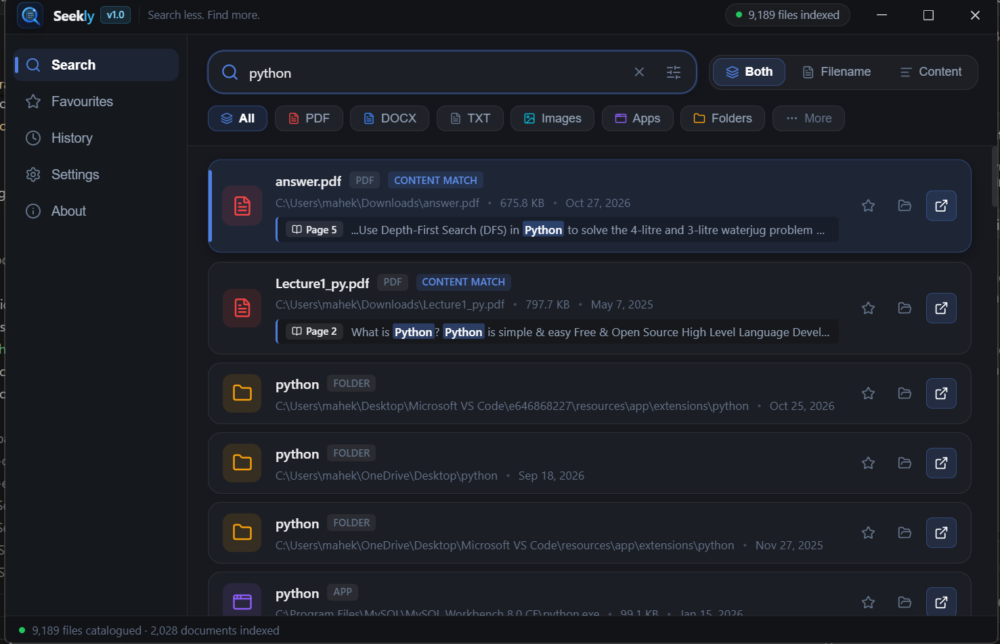
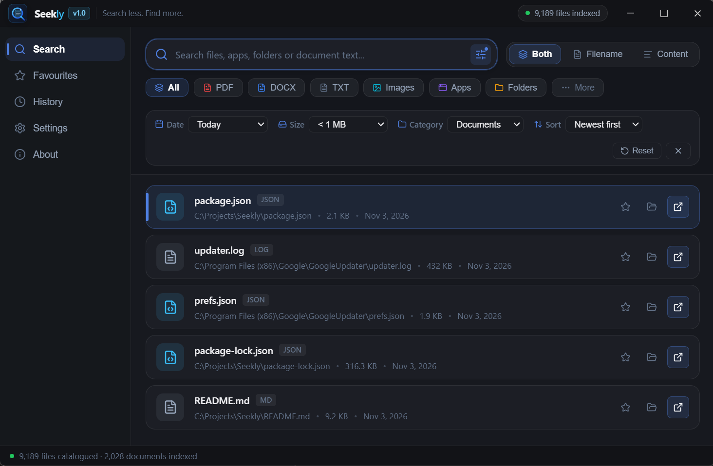
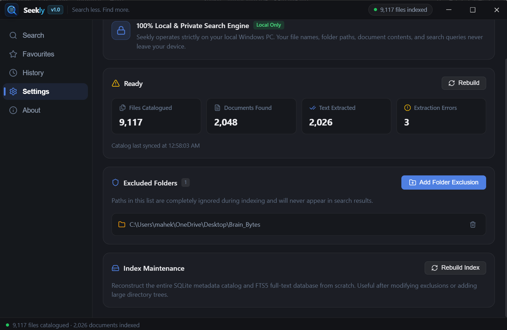

<div align="center">

# ⚡ Seekly

### Ultra-Fast, Local-First Windows Desktop Search & Document Content Launcher

[](https://microsoft.com)
[](https://electronjs.org)
[](https://react.dev)
[](https://sqlite.org)
[](LICENSE)

*Seekly is a lightweight, keyboard-driven floating search launcher for Windows that instantly indexes your files, applications, and the deep contents of PDF, DOCX, and TXT documents — 100% locally with zero cloud telemetry.*

---

</div>

## 📌 Project Overview

Traditional Windows search can be sluggish, cluttered with web results, and inconsistent when searching inside file contents. **Seekly** provides a clean, dark-glass floating command palette summoned anytime with a single global shortcut:

$$\text{\bf Ctrl + Space}$$

Seekly searches:
1. **Files by filename and metadata**
2. **Folders by name**
3. **Installed Windows applications and Start Menu shortcuts**
4. **Text inside PDF documents** (with page-level citations)
5. **Text inside Microsoft Word (DOCX) documents**
6. **Text inside plain text (TXT) files**

All indexing runs asynchronously in the background. User data and document contents **never** leave your local computer.

---

## 📸 Screenshots

| Main Search Launcher | Document Content Snippets |
| :---: | :---: |
|  |  |

| Advanced Filter Panel | Privacy & Exclusions |
| :---: | :---: |
|  |  |

---

## ✨ Key Features

- **⚡ Instant Summon & Dismiss:** Press `Ctrl + Space` anywhere in Windows to toggle the floating search launcher; press `Esc` to hide.
- **📄 Deep Document Content Search:** Powered by **SQLite FTS5 (Full-Text Search 5)** with BM25 ranking. Search actual text inside PDFs, Word documents, and text files.
- **📑 PDF Page-Level Matching:** Matching search results from PDFs display exact page number badges (e.g., `Page 3`) alongside highlighted text snippets.
- **🎯 3 Intuitive Search Modes:**
  - `Both`: Search filenames and extracted document contents simultaneously.
  - `Filename`: Fast search restricted strictly to filenames and directory names.
  - `Content`: Deep search restricted to indexed document contents.
- **🔍 Advanced Multi-Criteria Filters:**
  - **File Type:** Quick filter chips for PDF, DOCX, TXT, Images, Applications, and Folders.
  - **Category:** Documents, Images, Videos, Audio, Folders, Applications, Other.
  - **Modified Date:** Today, Last 7 days, Last 30 days, or Any time.
  - **File Size:** Below 1 MB, 1–10 MB, 10–100 MB, Above 100 MB, or Any size.
  - **Location Prefix:** Filter specifically to Desktop, Documents, Downloads, or any subfolder.
  - **Sort By:** Relevance, Name (A–Z), Modified Date, or File Size.
- **⭐ Bookmarks & Favorites:** Pin important files and folders with a single click. Broken favorites (deleted from disk) are safely auto-pruned.
- **🕒 Local Search History:** Fast recall of recent queries with individual deletion or one-click clearing. Can be disabled anytime.
- **🛡️ 100% Local Privacy:**
  - Zero telemetry, zero analytics, zero external API requests.
  - Custom folder exclusions: Exclude private directories from indexing. Excluded directories are automatically purged from local indexes.
- **👁️ Background Indexing & Filesystem Watcher:**
  - Background recursive scanner with zero UI lag.
  - Native filesystem monitoring via `chokidar` detecting added, renamed, modified, and deleted files with debouncing.
  - File size safeguards (up to 25 MB document extraction ceiling).

---

## 🛠️ Technology Stack

| Layer | Technologies |
| :--- | :--- |
| **Frontend** | React 18, Vite 6, Lucide Icons, Pure CSS Design System |
| **Desktop Shell** | Electron 34 (`contextIsolation: true`, `nodeIntegration: false`, `sandbox: true`) |
| **Database** | SQLite 3 via `better-sqlite3`, SQLite FTS5 (Full-Text Search 5) |
| **Document Processing** | `pdf-parse` (PDF page text extraction), `mammoth` (DOCX extraction), Safe UTF-8 Reader (TXT) |
| **Filesystem Watcher** | `chokidar` (debounced event queue) |
| **Packaging** | `electron-builder` (Windows NSIS installer) |
| **Testing** | Vitest 3 running natively under Electron Node ABI |

---

## 🏗️ Architecture

```
Windows Filesystem (Desktop, Documents, Downloads, Start Menu)
                     │
                     ▼
        Background Indexer & File Watcher (chokidar)
                     │
                     ▼
       Document Extraction Queue (PDF, DOCX, TXT)
                     │
                     ▼
        Local SQLite Database & FTS5 Full-Text Index
                     │
                     ▼
      Search Engine (Metadata Scoring + BM25 FTS Ranking)
                     │
                     ▼
         Electron Main Process (electron/main.cjs)
                     │
          Secure IPC & contextBridge (electron/preload.cjs)
                     │
                     ▼
       React Frontend (Frameless Dark Glass Floating Window)
```

---

## ⌨️ Keyboard Navigation

| Shortcut | Action |
| :--- | :--- |
| `Ctrl + Space` | Toggle Seekly launcher from anywhere in Windows |
| `Esc` | Close filter panel / Clear search query / Hide window |
| `↑` / `↓` | Move selection up / down through search results |
| `Enter` | Open selected file or launch application |
| `Alt + Enter` | Reveal selected file in Windows Explorer |

---

## 🚀 Getting Started

### Prerequisites

- **Windows 10** or **Windows 11** (64-bit)
- **Node.js** v20+ or v22+
- **npm** v10+
- **Git**

### Installation

1. **Clone the repository:**
   ```bash
   git clone https://github.com/your-username/seekly-desktop.git
   cd seekly-desktop
   ```

2. **Install dependencies:**
   ```bash
   npm install
   ```

3. **Rebuild native SQLite module for Electron:**
   ```bash
   npm run rebuild
   ```

### Running Locally in Development

Run both the Vite dev server and Electron simultaneously:

```bash
npm run dev
```

Alternatively, run in two separate terminals:
```bash
# Terminal 1: React renderer
npm run dev:renderer

# Terminal 2: Electron desktop process
npm run dev:electron
```

### Running Automated Tests

Run the complete test suite (Database, Metadata Indexer, Search, Document Extraction, Filters, Productivity, and End-to-End):

```bash
npm test
```

---

## 📦 Building the Windows Installer

To build an unsigned standalone Windows installer (.exe via NSIS):

```bash
npm run dist
```

The compiled installer will be saved to the `release/` directory:
- `release/Seekly Setup 1.0.0.exe`

> **Note on Windows SmartScreen:** Because the installer is built locally without an expensive commercial code-signing certificate, Windows SmartScreen may show an "Unrecognized app" prompt on first run. Click **More info → Run anyway** to proceed.

---

## 💾 Database Location

Seekly stores its SQLite database and search index in your standard Windows User Data folder:

`%APPDATA%\seekly-desktop\seekly.db`

To wipe all data or start fresh:
1. Use the **Rebuild Index** button in Seekly's Privacy tab, or
2. Delete the `%APPDATA%\seekly-desktop` directory.

---

## 🔒 Security & Privacy

- **Zero Remote Calls:** Seekly makes no network requests.
- **Isolated Context:** `contextIsolation: true` and `nodeIntegration: false` prevent renderer scripts from executing shell or Node.js commands.
- **Strict Preload Bridge:** Only pre-validated, typed IPC endpoints are exposed to the UI via `contextBridge`.
- **Exclusion Enforcement:** Excluded folders are never indexed, and adding a folder immediately purges any existing records from SQLite.

---

## 🗺️ V2 Roadmap

- [ ] OCR text extraction for scanned/image-only PDFs (via Tesseract).
- [ ] Support for additional document types (`.xlsx`, `.pptx`, `.csv`).
- [ ] Configurable global hotkey selector in UI.
- [ ] System tray icon with quick actions and auto-start on Windows boot.
- [ ] Regex and boolean search expressions (`AND`, `OR`, `NOT`).

---

## 🤝 Contributing

Contributions are welcome! Please feel free to submit a Pull Request.

1. Fork the Project
2. Create your Feature Branch (`git checkout -b feature/AmazingFeature`)
3. Commit your Changes (`git commit -m 'Add some AmazingFeature'`)
4. Push to the Branch (`git push origin feature/AmazingFeature`)
5. Open a Pull Request

---

## 📄 License

Distributed under the MIT License. See [LICENSE](LICENSE) for more information.
